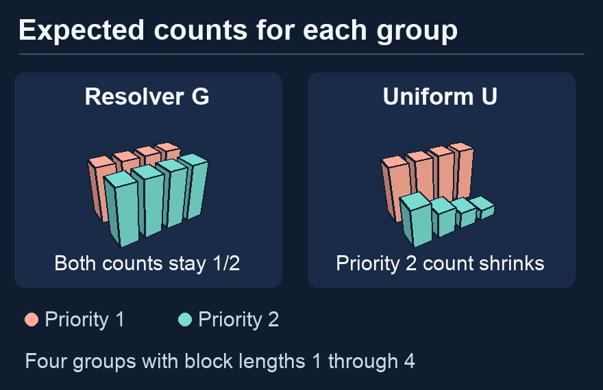

# Almost-sure parity resolvers can depend on transition probabilities

   

A four-state parity automaton has two memoryless full-support resolvers. The first accepts every fixed input almost surely. The uniform resolver almost surely rejects a specific fixed input. Their distributions differ at one state and letter.

[Read the paper](paper/manuscript.pdf) · [LaTeX source](paper/manuscript.tex) · [Original question](https://drops.dagstuhl.de/storage/00lipics/lipics-vol345-mfcs2025/LIPIcs.MFCS.2025.57/LIPIcs.MFCS.2025.57.pdf#page=16) · [Version DOI](https://doi.org/10.5281/zenodo.24572568)

## Explore the proof in 3D

For each positive length n, the separating input has a group of 2ⁿ copies of aⁿ#. The expected priority 1 count is 1/2 under both resolvers. The expected priority 2 count is 1/2 under the almost-sure resolver and (2/3)ⁿ/2 under the uniform one. The bars represent expected occurrence counts for one group.

[Download the offline explorer](https://raw.githubusercontent.com/DannyExperiments/same-support-parity-resolvers/v1.0.0/visualization/parity-blocks-explorer.zip) · [Explorer source](visualization/index.html) · [Worked example](proof/worked-block.md) · [GIF rendering source](visualization/render.py)

## Why the proof works

A separator chooses its successor independently of the priority it emits. Each block’s closing priority therefore uses a disjoint set of random choices. The Borel–Cantelli lemmas turn summability or divergence of the block probabilities into an almost-sure parity verdict.

The qualitative answer already follows from a common-support family of Baier, Bertrand and Größer, a support-preserving zero–one conversion and a parity product. This release gives a compact four-state instance and direct elementary proof. [Primary-source comparison](audits/public_safe_reports/LITERATURE.md)

## Reproduce the checks

    python3 -I scripts/verify_repository.py
    python3 -I verification/src/replay.py

[Recorded replay](verification/results/replay.txt) · [Scope](CLAIM_SCOPE_AND_LIMITATIONS.md) · [Reproducibility](REPRODUCIBILITY.md) · [Research disclosure](AI_DISCLOSURE.md)

## Cite

DannyExperiments. *Almost-sure parity resolvers can depend on transition probabilities*. Version 1.0.0, 27 November 2026. [Version DOI](https://doi.org/10.5281/zenodo.24572568).
