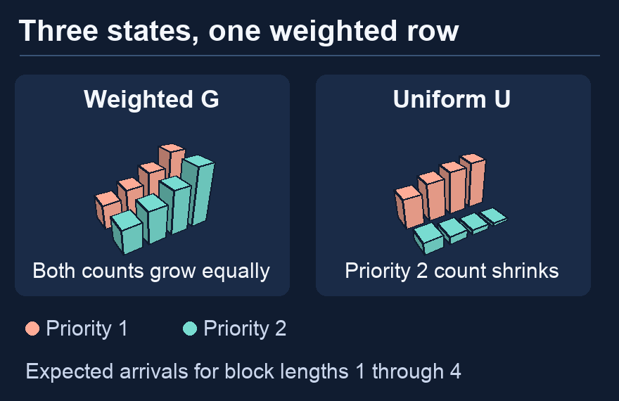

# Almost-sure parity resolvers can depend on transition probabilities

   

A three-state parity automaton over two letters has two full-support memoryless resolvers that differ at one row. The weighted resolver accepts each fixed input almost surely. The uniform resolver almost surely rejects a fixed input.

[Read the paper](paper/manuscript.pdf) · [LaTeX source](paper/manuscript.tex) · [Original question](https://doi.org/10.4230/LIPIcs.MFCS.2025.57) · [Version DOI](https://doi.org/10.5281/zenodo.24574027) · [Original four-state witness](#original-four-state-witness)

## Explore the proof in 3D

For the group of eight blocks with three a's in each block, the weighted resolver expects 32/27 occurrences of each of priorities 1 and 2. The uniform resolver expects 65/54 occurrences of priority 1 and 4/27 of priority 2. The bars show expected counts across the group. Select a block length and change resolver to see the exact fractions.

[Download the offline explorer](https://raw.githubusercontent.com/DannyExperiments/same-support-parity-resolvers/v1.1.0/visualization/three-state-blocks-explorer.zip) · [Explorer source](visualization/three-state.html) · [Worked example](proof/worked-three-state-block.md) · [GIF rendering source](visualization/render_three_state.py)

## Why the three-state proof works

The separator resets independently and records a priority from its source state. The weighted a-transition row feeds enough probability from S into R to keep the live-state masses equal. With uniform weights, priority 1 remains frequent enough to recur infinitely often on the separating word, while the total probability of priority 2 is finite. The Borel–Cantelli lemmas give the almost-sure verdicts.

The qualitative separation follows from older probabilistic automata constructions. The revised manuscript gives the three-state proof and preserves the four-state proof. [Prior result and scope](audits/public_safe_reports/THREE_STATE_LITERATURE.md)

## Original four-state witness

Version 1.0.0 gives the four-state construction. Its two delay states let the two surviving branches avoid feeding each other. The full original proof appears in Section 2 of the revised paper.

[Original construction](proof/recovered-construction.md) · [Four-state explorer](https://raw.githubusercontent.com/DannyExperiments/same-support-parity-resolvers/v1.0.0/visualization/parity-blocks-explorer.zip) · [v1.0.0 release](https://github.com/DannyExperiments/same-support-parity-resolvers/releases/tag/v1.0.0) · [v1.0.0 DOI](https://doi.org/10.5281/zenodo.24572568)

## Reproduce the checks

    python3 -I scripts/verify_repository.py
    python3 -I verification/src/replay.py

[Combined replay output](verification/results/replay.txt) · [Reproducibility](REPRODUCIBILITY.md) · [Scope](CLAIM_SCOPE_AND_LIMITATIONS.md) · [Research disclosure](AI_DISCLOSURE.md)
